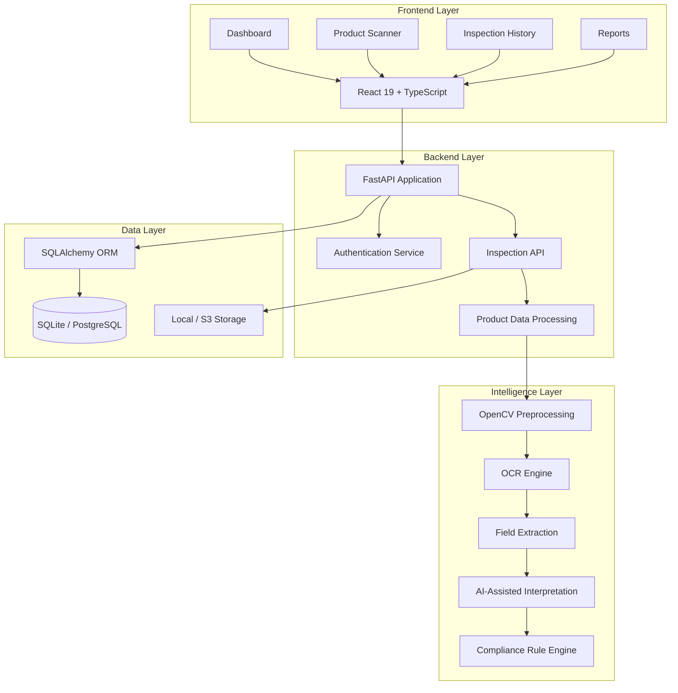
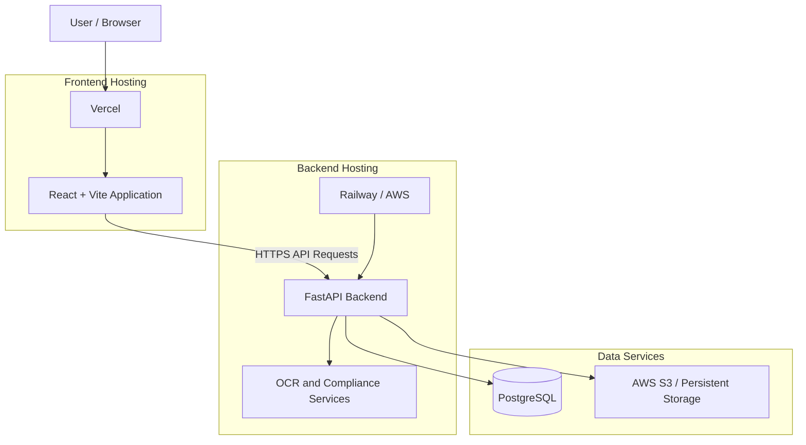

<div align="center">

# DISHA

### AI-Powered Packaged Commodity Label Compliance System

**An intelligent inspection platform for verifying packaged commodity labels under India's Legal Metrology (Packaged Commodities) Rules, 2011.**

<br/>


<br/>

[Overview](#-overview) •
[Features](#-key-features) •
[Architecture](#-system-architecture) •
[Technology](#-technology-stack) •
[Installation](#-getting-started) •
[API](#-api-reference) •
[License](#-license)

</div>

---

## 📌 Overview

DISHA is an AI-assisted packaged commodity label inspection system designed to help identify missing, unclear, or potentially non-compliant declarations on product packaging.

The platform combines Optical Character Recognition (OCR), computer vision, intelligent field interpretation, and a deterministic rule-based compliance engine to evaluate information printed on product labels.

The system is designed around the **Legal Metrology (Packaged Commodities) Rules, 2011**, helping users inspect important declarations such as:

- Maximum Retail Price (MRP)
- Net quantity
- Manufacturer, packer, and importer details
- Date of manufacture or packing
- Expiry date or best-before declaration
- Consumer care information
- Country of origin, where applicable
- Unit sale price

DISHA converts a product-label image into structured information, evaluates applicable compliance checks, and generates an inspection result with supporting evidence.

### 🎯 The Core Idea

Traditional manual label inspection can be time-consuming and difficult to standardize.

DISHA aims to make the process:

- **Faster:** Automate the extraction of printed declarations.
- **Structured:** Convert unstructured label images into organized data.
- **Explainable:** Associate findings with specific compliance rules.
- **Evidence-driven:** Preserve extracted text and inspection evidence.
- **Consistent:** Use deterministic rules for compliance evaluation.

> DISHA is an inspection-assistance platform. Its output is not a substitute for official legal or regulatory determination.

---

## ✨ Key Features

### 1. Product Label Scanning

- Upload product/package images.
- Capture images using a camera.
- Process images using computer vision.
- Extract printed text using OCR.
- Retain OCR confidence and location information where available.

### 2. Intelligent Declaration Extraction

The extraction pipeline identifies relevant product declarations, including:

| Declaration | Extracted Information |
|---|---|
| Product name | Generic/common product name |
| Manufacturer | Manufacturer or packer details |
| Importer | Importer details, where applicable |
| MRP | Maximum Retail Price |
| Net quantity | Weight, volume, or count |
| Manufacturing date | Manufacture/packing/import date |
| Expiry | Expiry or best-before declaration |
| Consumer care | Contact details for consumer complaints |
| Country of origin | Origin declaration, where applicable |
| Unit sale price | Price per standard unit, where applicable |

### 3. AI-Assisted Interpretation

- Handles ambiguous OCR output.
- Helps interpret uncertain declaration candidates.
- Supports optional AI-assisted field interpretation.
- Keeps legal compliance decisions separate from generative AI.

**Important:** AI interpretation does not independently decide whether a product is legally compliant.

### 4. Rule-Based Compliance Engine

- Evaluates individual compliance rules.
- Identifies missing or unclear declarations.
- Generates rule-wise findings.
- Supports critical-rule overrides.
- Distinguishes an unassessable image from a non-compliant product.

### 5. Inspection Dashboard

- View inspection summaries.
- Review compliance results.
- Access previous inspections.
- Examine individual rule findings.
- Monitor inspection outcomes.

### 6. Inspection Reports

- Generate inspection reports.
- Present extracted product information.
- Display rule-wise compliance findings.
- Provide evidence to support inspection results.

---

## 🔄 How DISHA Works

The system follows a multi-stage inspection pipeline.


### Pipeline Explanation

| Stage | Description |
|---|---|
| Image input | Receives a product label image |
| Preprocessing | Improves image quality for text recognition |
| OCR | Extracts text from the image |
| Parsing | Identifies relevant product declarations |
| Interpretation | Resolves ambiguous field candidates |
| Compliance | Evaluates applicable rules |
| Reporting | Generates findings and inspection reports |

---

## ⚖️ Compliance Evaluation

DISHA uses a deterministic rule-based approach for its compliance evaluation.

The AI layer may assist with interpreting unclear text, but the final rule evaluation is performed by the compliance engine.

### Configured Rule Registry

| Rule ID | Legal Reference | Inspection Area |
|---|---|---|
| `RULE_6_1_A` | Rule 6(1)(a) | Manufacturer / packer / importer details |
| `RULE_6_1_B` | Rule 6(1)(b) | Generic or common product name |
| `RULE_6_1_C` | Rule 6(1)(c) | Net quantity |
| `RULE_6_1_D` | Rule 6(1)(d) | Date declaration |
| `RULE_6_1_E` | Rule 6(1)(e) | Retail sale price / MRP |
| `RULE_6_1_F` | Rule 6(1)(f) | Consumer care information |
| `RULE_6_1_AA` | Rule 6(1)(aa) | Country of origin, where applicable |
| `RULE_6_2_FONT` | Rule 6(2) | Declaration font-height check |
| `RULE_6_10_USP` | Rule 6(10) | Unit sale price |

**Note:** This table describes the currently configured rule registry. It does not claim exhaustive coverage of every applicable provision, exemption, amendment, or legal interpretation.

### Compliance Scoring

The configured scoring approach is:

`Compliance Score = (Passed Checks / Total Evaluated Checks) × 100`

The current result classification is:

| Condition | Result |
|---|---|
| Score ≥ 80% | COMPLIANT |
| Score ≥ 60% and < 80% | NEEDS_REVIEW |
| Score < 60% | NON_COMPLIANT |
| Critical rule failure | NON_COMPLIANT |
| Insufficient evidence to evaluate | UNABLE_TO_ASSESS |

A critical-rule failure can override a high numerical score.

`UNABLE_TO_ASSESS` is a separate outcome, not a zero score. For example, an image that does not contain a recognizable product label should not receive an invented compliance score.

---

## 🏗️ System Architecture

DISHA follows a modular architecture that separates the frontend, backend services, OCR processing, AI-assisted interpretation, and compliance evaluation.

### High-Level Architecture



### Core Components

| Component | Responsibility |
|---|---|
| Frontend | User interface and inspection workflow |
| FastAPI | Backend API and request handling |
| OpenCV | Image preprocessing |
| OCR Engine | Text recognition from product labels |
| Extraction Service | Declaration identification and parsing |
| AI Service | Optional interpretation of ambiguous fields |
| Compliance Engine | Deterministic rule evaluation |
| SQLAlchemy | Database interaction |
| Storage Service | Image and report storage |

---

## 🧰 Technology Stack

### Frontend

| Technology | Purpose |
|---|---|
| React 19 | Component-based user interface |
| TypeScript | Type-safe frontend development |
| Vite | Development server and build tool |
| Tailwind CSS | Styling and responsive layouts |
| Recharts | Dashboard visualizations |
| Lucide React | Interface icons |

### Backend

| Technology | Purpose |
|---|---|
| Python 3.11 | Backend development |
| FastAPI | REST API framework |
| Pydantic | Data validation |
| Uvicorn | ASGI application server |
| SQLAlchemy | Database ORM |
| Alembic | Database migrations |
| ReportLab | PDF report generation |

### AI and Computer Vision

| Technology | Purpose |
|---|---|
| OpenCV | Image processing and preprocessing |
| PaddleOCR | Text recognition |
| RapidOCR / ONNX | Alternative OCR processing |
| PyTesseract | Optional OCR support |
| Ox Alpha | Optional AI-assisted interpretation |
| Gemini API | Separate AI integration module, where configured |

### Database and Infrastructure

| Technology | Purpose |
|---|---|
| SQLite | Local development database |
| PostgreSQL | Hosted relational database |
| JWT | Authentication |
| Passlib / bcrypt | Password hashing |
| AWS S3 | Optional object storage |
| Docker | Containerization |
| Railway | Application hosting |
| Vercel | Frontend hosting |

---

## 📂 Project Structure

The repository is organized into frontend and backend modules.

```text
DISHA-PORTAL/
│
├── backend/
│   ├── app/
│   │   ├── api/
│   │   ├── core/
│   │   │   ├── config.py
│   │   │   └── database.py
│   │   │
│   │   ├── models/
│   │   ├── schemas/
│   │   ├── services/
│   │   │   ├── ingestion.py
│   │   │   ├── storage_service.py
│   │   │   └── ...
│   │   │
│   │   └── main.py
│   │
│   ├── tests/
│   ├── alembic/
│   ├── Dockerfile
│   └── requirements.txt
│
├── src/
│   ├── components/
│   ├── pages/
│   ├── services/
│   │   └── api.ts
│   ├── hooks/
│   ├── assets/
│   └── ...
│
├── public/
├── server/
├── Dockerfile
├── docker-compose.yml
├── package.json
├── vite.config.ts
├── README.md
├── LICENSE
└── .env.example
```

*Note: This is a high-level structural overview. Individual filenames and folders may vary between repository versions.*

---

## 🔌 API Reference

DISHA uses a REST-based backend architecture powered by FastAPI.

The API is responsible for authentication, image inspection, product data processing, and inspection history.

### Main API Areas

| API Area | Responsibility |
|---|---|
| Authentication | User registration and login |
| Inspection | Product image submission and inspection |
| Product Data | Extracted declaration information |
| Compliance | Rule-wise evaluation and findings |
| History | Previous inspection records |
| Reports | Inspection report generation |

### API Documentation

When the backend is running locally, FastAPI provides interactive API documentation:

| Documentation | URL |
|---|---|
| Swagger UI | `http://localhost:8000/docs` |
| ReDoc | `http://localhost:8000/redoc` |

For the exact endpoint paths, request schemas, and response formats, refer to the FastAPI route definitions in the repository.

---

## 🚀 Getting Started

Follow these instructions to run DISHA locally.

### Prerequisites

Make sure the following tools are installed:

- Python 3.11
- Node.js and npm
- Git
- VS Code (recommended)

### 1. Clone the Repository

```bash
git clone https://github.com/heyytrayamm/Disha-Portal.git

cd Disha-Portal
```

### 2. Backend Setup

Navigate to the backend directory:

```bash
cd backend
```

Create a virtual environment:

**Windows:**

```bash
python -m venv venv
```

Activate it:

```bash
venv\Scripts\activate
```

Install dependencies:

```bash
pip install -r requirements.txt
```

If the project version uses `pyproject.toml` for dependency management, follow its installation instructions instead.

### 3. Configure Environment Variables

Create a `.env` file using the provided example:

**Windows:**

```bash
copy .env.example .env
```

Update the values according to your local configuration.

### 4. Start the Backend

From the backend directory, run:

```bash
uvicorn app.main:app --reload --host 0.0.0.0 --port 8000
```

The backend should now be accessible at:

```text
http://localhost:8000
```

API documentation:

```text
http://localhost:8000/docs
```

### 5. Frontend Setup

Open another terminal and navigate to the project root:

```bash
cd Disha-Portal
```

Install frontend dependencies:

```bash
npm install
```

Create a frontend environment file named `.env`:

```env
VITE_API_URL=http://localhost:8000
```

Start the development server:

```bash
npm run dev
```

Vite will display the local frontend URL in the terminal.

Open that URL in your browser.

---

## ⚙️ Environment Configuration

DISHA uses environment variables to configure backend services and frontend API communication.

### Frontend Variables

| Variable | Description |
|---|---|
| `VITE_API_URL` | Backend API base URL |

### Backend Variables

The exact variables depend on the active configuration in `backend/app/core/config.py` and `.env.example`.

Common configuration categories include:

| Configuration | Purpose |
|---|---|
| Database URL | Database connection |
| JWT secret | Token signing |
| CORS origins | Allowed frontend origins |
| OCR configuration | OCR engine selection |
| AI API key | Optional AI integration |
| AWS access key | Optional S3 authentication |
| AWS secret key | Optional S3 authentication |
| S3 bucket | Object storage destination |
| AWS region | Storage region |

**Security:** Never commit `.env` files, API keys, database passwords, JWT secrets, or cloud credentials to GitHub.

---

## 🗄️ Database and Storage

### Database

DISHA uses SQLAlchemy for database interaction.

Supported database configurations include:

- SQLite for local development.
- PostgreSQL for hosted deployments.

### Image and File Storage

The storage service supports:

- Local filesystem storage.
- Optional AWS S3 object storage.

For production deployments, persistent object storage is recommended. Files stored only on an ephemeral deployment filesystem may be lost when the application restarts or redeploys.

---

## 🧪 Testing

DISHA includes backend tests to verify important application functionality.

The backend testing framework uses **pytest**.

### Run Backend Tests

Navigate to the backend directory:

```bash
cd backend
```

Activate your virtual environment and run:

```bash
pytest -v
```

To run tests with coverage (if `pytest-cov` is installed):

```bash
pytest --cov=app
```

### Testing Objectives

| Area | Testing Objective |
|---|---|
| API endpoints | Verify request and response behaviour |
| Health checks | Confirm backend availability |
| Image ingestion | Validate image ingestion workflows |
| OCR processing | Check text extraction behaviour |
| Declaration extraction | Verify structured field extraction |
| Compliance engine | Validate rule evaluation |
| Authentication | Check authentication workflows |

> Test coverage and accuracy percentages should be reported only after running reproducible tests on the current project version.

---

## ☁️ Deployment

DISHA supports a deployment architecture in which the frontend and backend can be hosted independently.

### Deployment Architecture



### Frontend Deployment — Vercel

1. Import the DISHA GitHub repository into Vercel.
2. Select the appropriate frontend root directory.
3. Configure the build settings according to `package.json`.
4. Add the backend API URL as an environment variable.

```env
VITE_API_URL=https://your-backend-domain.com
```

5. Deploy the application.

**Important:** `VITE_API_URL` is a build-time frontend variable. Redeploy the frontend after changing it.

### Backend Deployment — Railway

1. Connect the GitHub repository to Railway.
2. Configure the backend service to use the backend Dockerfile or the appropriate start command.
3. Add the required environment variables.
4. Configure the database connection.
5. Set the allowed CORS origins to include the deployed frontend domain.
6. Deploy the backend.
7. Verify the health endpoint and API documentation.

### AWS Integration

The storage service supports optional AWS S3 configuration.

When enabled, S3 can be used for storing inspection images and related files.

Configure the required AWS credentials, region, and bucket through environment variables.

Do not expose AWS credentials in frontend code or commit them to the repository.

### Production Deployment Checklist

- [ ] Frontend points to the correct backend URL.
- [ ] Backend CORS allows the frontend domain.
- [ ] Database connection is configured.
- [ ] Database migrations are applied where required.
- [ ] Persistent image storage is configured.
- [ ] JWT secret is securely configured.
- [ ] API credentials are stored as environment variables.
- [ ] HTTPS is enabled.
- [ ] Health endpoint is accessible.
- [ ] Image upload and inspection workflow is tested.
- [ ] PDF report generation is tested.

> Deployment providers and configurations may vary. Verify the active Git branch and deployment settings before merging or pushing changes to a production branch.

---

## 🔐 Security and Privacy

DISHA processes product images and extracted product declarations during inspections.

Security considerations include:

- JWT-based authentication.
- Password hashing using bcrypt.
- Environment-based secret management.
- Backend-side API credential handling.
- Configurable CORS restrictions.
- Controlled file storage.
- Input validation through Pydantic.

### Security Recommendations

For production use:

1. Use HTTPS for all application communication.
2. Never expose secret keys in frontend code.
3. Restrict file uploads by size and supported format.
4. Validate uploaded files before image processing.
5. Use strong JWT secrets.
6. Restrict database and cloud storage permissions.
7. Avoid storing unnecessary personal information.
8. Review logs before including sensitive information.

---

## ⚠️ Current Limitations

DISHA is an AI-assisted inspection system, and its results depend on image quality, OCR performance, field extraction, and the configured compliance rules.

Known limitations and considerations include:

- Blurry or low-resolution images may reduce OCR accuracy.
- Glare, shadows, and distorted packaging can affect extraction.
- Some declarations may be difficult to associate with the correct field.
- AI-assisted interpretation may require manual verification.
- Not every legal exemption or special product category may be covered.
- Font-height and visual declaration checks may require more precise image analysis.
- A product image may not contain enough evidence to evaluate every rule.
- Legal requirements may change through amendments and notifications.

### Important Compliance Disclaimer

DISHA is intended to assist with preliminary packaged commodity label inspection.

A generated result should not be treated as a final legal determination or official enforcement decision.

All findings should be reviewed against the applicable legal provisions, amendments, exemptions, and authoritative guidance.

---

## 🔭 Future Scope

The following improvements can strengthen DISHA over time.

### 1. Advanced OCR and Computer Vision

- Improve OCR performance on curved packaging.
- Support multilingual label recognition.
- Improve declaration detection in complex layouts.
- Introduce better image-quality assessment.

### 2. Expanded Compliance Coverage

- Expand the legal rule registry.
- Add more product-specific checks.
- Improve exemption handling.
- Maintain versioned legal rules.
- Track changes in applicable regulations.

### 3. Better Evidence and Explainability

- Highlight the exact declaration location on the image.
- Link every finding to its supporting evidence.
- Provide clearer explanations for failed checks.
- Improve inspection traceability.

### 4. Inspection Management

- Advanced inspection analytics.
- Improved inspection history.
- Exportable reports.
- Role-based access control.
- Better administrative workflows.

### 5. AI Improvements

- Better ambiguity resolution.
- Confidence-aware extraction.
- Human-in-the-loop verification.
- More robust multilingual interpretation.

---

## 📚 Legal References and Resources

The project is based on the regulatory framework of India's Legal Metrology (Packaged Commodities) Rules, 2011.

For legal verification and implementation updates, consult authoritative government sources.

- [Department of Consumer Affairs](https://consumeraffairs.nic.in/)
- [Legal Metrology Division](https://consumeraffairs.nic.in/)
- [India Code](https://www.indiacode.nic.in/)

**Note:** Always verify the latest applicable rules, amendments, notifications, and exemptions before using the system for regulatory decisions.

---

## 🤝 Contributing

Contributions, suggestions, and improvements are welcome.

If you would like to contribute:

1. Fork the repository.
2. Create a feature branch.
3. Make your changes.
4. Run the relevant tests.
5. Commit your changes.
6. Open a pull request with a clear description.

Example:

```bash
git checkout -b feat/your-feature-name

git add .

git commit -m "feat: add your feature description"

git push origin feat/your-feature-name
```

---

## 👨‍💻 Project Information

**Project:** DISHA

**Domain:** Artificial Intelligence, Computer Vision and Legal Metrology

**Problem Statement:** SIH26034

**Focus:** Automated packaged commodity label compliance assistance.

**Repository:** [Disha-Portal](https://github.com/heyytrayamm/Disha-Portal)

---

## 📄 License

This project is licensed under the **MIT License**.

See the [LICENSE](LICENSE) file for details.

---

<div align="center">

### DISHA

**Making packaged commodity label inspection smarter, structured, and more explainable.**

Built with ❤️ for a more transparent product-label ecosystem.

</div>