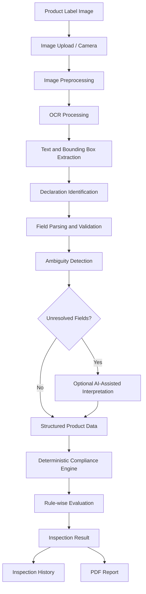
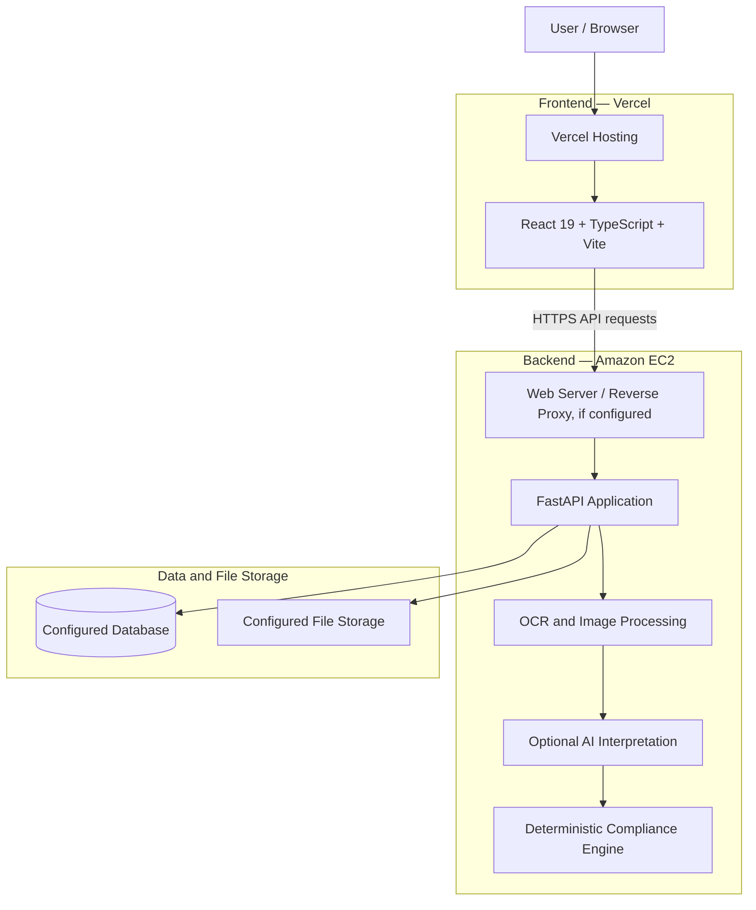

<div align="center">

# DISHA

### AI-Powered Packaged Commodity Label Compliance System

**An intelligent inspection platform for verifying packaged commodity labels under India's Legal Metrology (Packaged Commodities) Rules, 2011.**


[Overview](#-overview) • [Features](#-key-features) • [Workflow](#-how-disha-works) • [Architecture](#-system-architecture) • [Technology](#-technology-stack) • [Setup](#-getting-started) • [Deployment](#-production-deployment) • [License](#-license)

</div>

---

## 📌 Overview

DISHA is an AI-assisted packaged commodity label inspection system designed to help identify missing, unclear, or potentially non-compliant declarations on product packaging.

The platform combines Optical Character Recognition (OCR), computer vision, optional AI-assisted field interpretation, and a deterministic rule-based compliance engine to evaluate information printed on product labels.

DISHA is designed around India's **Legal Metrology (Packaged Commodities) Rules, 2011**. It helps inspect declarations such as:

- Maximum Retail Price (MRP)
- Net quantity
- Manufacturer, packer, and importer details
- Date of manufacture, packing, or import
- Expiry or best-before declaration
- Consumer care information
- Country of origin, where applicable
- Unit sale price, where applicable

A user submits a product-label image. DISHA processes the image, extracts relevant declarations, evaluates configured compliance checks, and presents an inspection result with rule-wise findings.

### 🎯 Project Objectives

- Reduce repetitive manual examination of packaged commodity labels.
- Extract relevant product declarations from label images.
- Organize unstructured OCR output into structured product information.
- Assist with ambiguous text interpretation without delegating legal decisions to generative AI.
- Evaluate configured compliance checks consistently.
- Present explainable findings and supporting evidence.
- Maintain inspection records and generate reports.

> DISHA is an inspection-assistance platform. Its output is not a substitute for an official legal or regulatory determination.

---

## ✨ Key Features

### 1. Product Label Scanning

- Upload product or package images.
- Capture product images using a camera, where supported by the interface.
- Preprocess images before text recognition.
- Extract printed text using OCR.
- Retain OCR confidence and location information where available.

### 2. Intelligent Declaration Extraction

| Declaration | Extracted information |
|---|---|
| Product name | Generic or common product name |
| Manufacturer / packer | Relevant business details |
| Importer | Importer details, where applicable |
| MRP | Maximum Retail Price |
| Net quantity | Weight, volume, or count |
| Date declaration | Manufacture, packing, or import date |
| Expiry | Expiry or best-before declaration |
| Consumer care | Consumer complaint contact information |
| Country of origin | Origin declaration, where applicable |
| Unit sale price | Price per standard unit, where applicable |

### 3. AI-Assisted Interpretation

- Helps interpret ambiguous OCR candidates.
- Can assist with unclear or incomplete field values.
- Supports optional AI-assisted field interpretation.
- Keeps AI-assisted interpretation separate from deterministic compliance evaluation.

**Important:** AI interpretation does not independently determine whether a product is legally compliant. Extracted information and findings should be reviewed against the source image and applicable rules.

### 4. Rule-Based Compliance Engine

- Evaluates configured compliance rules.
- Identifies missing, unclear, or potentially non-compliant declarations.
- Produces rule-wise findings.
- Supports critical-rule overrides.
- Distinguishes insufficient evidence from a failed compliance check.

### 5. Inspection Dashboard and History

- View inspection summaries.
- Review extracted product information.
- Examine rule-wise findings.
- Access previous inspection records, where enabled.
- Review inspection outcomes.

### 6. Inspection Reports

- Generate PDF inspection reports.
- Present extracted product information.
- Display rule-wise compliance findings.
- Provide supporting inspection evidence where available.

---

## 🔄 How DISHA Works



### Workflow Explanation

| Stage | Description |
|---|---|
| Image input | Receives a product-label image |
| Preprocessing | Improves image suitability for text recognition |
| OCR | Recognizes text and, where available, its location |
| Parsing | Identifies relevant product declarations |
| Interpretation | Assists with ambiguous field candidates |
| Compliance | Evaluates configured legal-metrology checks |
| Reporting | Presents findings and inspection reports |

---

## ⚖️ Compliance Evaluation

DISHA uses a deterministic rule-based approach for its configured compliance evaluation.

The AI layer may assist with interpreting unclear text, but the compliance verdict is produced by the rule engine.

### Configured Rule Registry

| Rule ID | Legal reference | Inspection area |
|---|---|---|
| `RULE_6_1_A` | Rule 6(1)(a) | Manufacturer / packer / importer details |
| `RULE_6_1_B` | Rule 6(1)(b) | Generic or common product name |
| `RULE_6_1_C` | Rule 6(1)(c) | Net quantity |
| `RULE_6_1_D` | Rule 6(1)(d) | Date declaration |
| `RULE_6_1_E` | Rule 6(1)(e) | Retail sale price / MRP |
| `RULE_6_1_F` | Rule 6(1)(f) | Consumer care information |
| `RULE_6_1_AA` | Rule 6(1)(aa) | Country of origin, where applicable |
| `RULE_6_2_FONT` | Rule 6(2) | Declaration font-height check |
| `RULE_6_10_USP` | Rule 6(10) | Unit sale price |

**Coverage note:** This table describes the configured rule registry, not exhaustive coverage of every legal provision, exemption, amendment, product category, or legal interpretation. Verify the latest applicable legal text before relying on an inspection result.

### Compliance Scoring

`Compliance Score = (Passed Checks / Total Evaluated Checks) × 100`

| Condition | Result |
|---|---|
| Score ≥ 80% | `COMPLIANT` |
| Score ≥ 60% and < 80% | `NEEDS_REVIEW` |
| Score < 60% | `NON_COMPLIANT` |
| Critical rule failure | `NON_COMPLIANT` |
| Insufficient evidence to evaluate | `UNABLE_TO_ASSESS` |

A critical-rule failure can override a high numerical score.

`UNABLE_TO_ASSESS` is a separate outcome, not a zero score. An image that does not contain a recognizable product label should not receive an invented compliance score.

---

## 🏗️ System Architecture

DISHA uses a decoupled deployment architecture:

- **Frontend:** React application deployed on Vercel.
- **Backend:** FastAPI application deployed on an Amazon EC2 instance.
- **API communication:** HTTPS requests from the Vercel frontend to the EC2-hosted backend.
- **Database and file storage:** Configured independently according to the active environment. PostgreSQL and AWS S3 are supported options where configured; their use should be confirmed in the deployment environment.

### Production Deployment Architecture



The reverse proxy, database, and storage components shown above represent deployment options and should be enabled only when configured in the actual environment.

### Request Flow

1. A user opens the DISHA frontend hosted on Vercel.
2. The frontend sends API requests to the configured FastAPI backend URL.
3. The EC2-hosted backend validates the request and processes the operation.
4. Image-processing, OCR, extraction, and compliance services run on the backend as applicable.
5. The backend returns structured results to the frontend.
6. Inspection records and uploaded files are stored using the configured database and storage services.

---

## 🧰 Technology Stack

### Frontend

| Technology | Purpose |
|---|---|
| React 19 | Component-based user interface |
| TypeScript | Type-safe frontend development |
| Vite | Development server and build tool |
| Tailwind CSS | Styling and responsive layouts |
| Recharts | Dashboard visualizations |
| Lucide React | Interface icons |
| Vercel | Frontend hosting and deployment |

### Backend

| Technology | Purpose |
|---|---|
| Python 3.11 | Backend development |
| FastAPI | REST API framework |
| Pydantic | Data validation |
| Uvicorn | ASGI application server |
| SQLAlchemy | Database ORM |
| Alembic | Database migrations, where configured |
| ReportLab | PDF report generation |
| Amazon EC2 | Backend compute and hosting |

### AI and Computer Vision

| Technology | Purpose |
|---|---|
| OpenCV | Image processing and preprocessing |
| PaddleOCR | Text recognition, where enabled |
| RapidOCR / ONNX | Alternative OCR processing, where enabled |
| PyTesseract | Optional OCR support |
| Ox Alpha | Optional AI-assisted interpretation |
| Gemini API | Separate AI integration module, where configured |

### Database, Security, and Infrastructure

| Technology | Purpose |
|---|---|
| SQLite | Local development database |
| PostgreSQL | Hosted relational database option |
| JWT | Authentication |
| Passlib / bcrypt | Password hashing, as configured |
| AWS S3 | Optional object storage |
| Docker | Containerization, where used |
| Amazon EC2 | Backend hosting |
| Vercel | Frontend hosting |

---

## 📂 Project Structure

The repository is organized into frontend and backend modules. The following is a high-level overview; exact filenames may vary by repository version.

```text
DISHA-PORTAL/
│
├── backend/
│   ├── app/
│   │   ├── api/
│   │   ├── core/
│   │   │   ├── config.py
│   │   │   └── database.py
│   │   ├── models/
│   │   ├── schemas/
│   │   ├── services/
│   │   │   ├── ingestion.py
│   │   │   ├── storage_service.py
│   │   │   └── ...
│   │   └── main.py
│   ├── tests/
│   ├── alembic/
│   ├── Dockerfile
│   └── requirements.txt
│
├── src/
│   ├── components/
│   ├── pages/
│   ├── services/
│   │   └── api.ts
│   ├── hooks/
│   └── assets/
│
├── public/
├── server/
├── Dockerfile
├── docker-compose.yml
├── package.json
├── vite.config.ts
├── README.md
├── LICENSE
└── .env.example
```

---

## 🔌 API Reference

DISHA uses a REST API powered by FastAPI.

The backend is responsible for authentication, image inspection, product-data processing, compliance evaluation, and inspection history, according to the implemented routes.

### Main API Areas

| API area | Responsibility |
|---|---|
| Authentication | User registration and login, if enabled |
| Inspection | Product image submission and inspection |
| Product data | Extracted declaration information |
| Compliance | Rule-wise evaluation and findings |
| History | Previous inspection records |
| Reports | Inspection report generation |

### Interactive API Documentation

When the backend is running, FastAPI can expose interactive API documentation at the following paths, if enabled:

| Documentation | Local example |
|---|---|
| Swagger UI | `http://localhost:8000/docs` |
| ReDoc | `http://localhost:8000/redoc` |

For the production API, use the actual EC2 backend domain or configured API base URL, followed by `/docs` or `/redoc` if public documentation is enabled.

Do not expose interactive API documentation publicly in production unless it is intentionally enabled and appropriately protected.

---

## 🚀 Getting Started

These instructions describe a local development setup. Production deployment is covered separately below.

### Prerequisites

- Python 3.11
- Node.js and npm
- Git
- VS Code (recommended)

### 1. Clone the Repository

```bash
git clone https://github.com/heyytrayamm/Disha-Portal.git
cd Disha-Portal
```

### 2. Backend Setup

```bash
cd backend
```

Create a virtual environment.

**Windows:**

```bash
python -m venv venv
venv\Scripts\activate
```

**macOS / Linux:**

```bash
python3 -m venv venv
source venv/bin/activate
```

Install dependencies using the dependency file present in the backend:

```bash
pip install -r requirements.txt
```

If the current project version uses `pyproject.toml` instead, follow the dependency instructions defined there.

### 3. Configure Backend Environment

Create a local `.env` file using the supplied example, if present.

**Windows:**

```bash
copy .env.example .env
```

**macOS / Linux:**

```bash
cp .env.example .env
```

Set the required local database, security, CORS, OCR, and optional AI settings based on the actual backend configuration.

Never commit the real `.env` file.

### 4. Run the Backend

From the backend directory, use the application entry point defined by the project. If it is `app.main:app`, run:

```bash
uvicorn app.main:app --reload --host 127.0.0.1 --port 8000
```

The local backend will be available at:

```text
http://127.0.0.1:8000
```

Interactive API documentation, if enabled:

```text
http://127.0.0.1:8000/docs
```

### 5. Frontend Setup

Open a second terminal at the repository root:

```bash
npm install
```

Create a frontend `.env` file:

```env
VITE_API_URL=http://127.0.0.1:8000
```

Start the development server:

```bash
npm run dev
```

Open the local URL printed by Vite.

**Note:** `VITE_API_URL` is a frontend build-time variable. Use the local backend URL for local development and the production EC2 API URL in the Vercel production environment.

---

## ⚙️ Environment Configuration

Environment variable names must match the application's actual configuration. Check `backend/app/core/config.py`, `.env.example`, and `src/services/api.ts` before adding or changing variables.

### Frontend

| Variable | Purpose |
|---|---|
| `VITE_API_URL` | Base URL of the FastAPI backend |

Local example:

```env
VITE_API_URL=http://127.0.0.1:8000
```

Vercel production example:

```env
VITE_API_URL=https://your-api-domain.example.com
```

Replace the example with the actual HTTPS URL used by the EC2 backend.

**Security:** Vite variables prefixed with `VITE_` are included in the client-side build. Never put passwords, private API keys, JWT signing secrets, or AWS credentials in them.

After changing `VITE_API_URL` in Vercel, trigger a new deployment so the updated value is included in the frontend build.

### Backend Configuration Categories

Depending on the active implementation, backend configuration may include:

| Configuration | Purpose |
|---|---|
| Database URL | Database connection |
| JWT secret | Token signing |
| CORS origins | Allowed frontend origins |
| OCR configuration | OCR engine selection |
| AI API key | Optional AI integration |
| AWS credentials / IAM role | AWS service access, if required |
| S3 bucket | Optional object storage |
| AWS region | AWS resource region |
| SMTP settings | Email delivery, if implemented |

Use the exact variable names documented in the backend configuration. Prefer an EC2 instance IAM role for AWS service access where appropriate instead of embedding long-lived AWS access keys on the instance.

Never commit `.env` files, API keys, database passwords, JWT secrets, private keys, or cloud credentials to GitHub.

---

## 🗄️ Database and File Storage

### Database

DISHA uses SQLAlchemy for database interaction.

The project supports SQLite for local development and PostgreSQL for hosted relational database configurations. Confirm which database is connected to the live EC2 deployment before describing it as the production database.

### File Storage

The storage service supports local filesystem storage and optional AWS S3 object storage.

For production:

- Confirm whether uploaded images are stored on the EC2 filesystem or in S3.
- If using EC2 local storage, configure persistent storage and backups.
- If using S3, restrict bucket access and use an IAM role where possible.
- Avoid exposing private object URLs or credentials in frontend code.
- Define a retention policy for uploaded images and generated reports.

An EC2 instance's local disk is not automatically equivalent to a managed, backed-up object-storage service.

---

## 🧪 Testing

The backend testing framework uses pytest.

### Run Backend Tests

From the backend directory, activate the virtual environment and run:

```bash
pytest -v
```

If `pytest-cov` is installed:

```bash
pytest --cov=app
```

### Frontend Build Check

From the frontend project root:

```bash
npm run build
```

### Testing Objectives

| Area | Testing objective |
|---|---|
| API endpoints | Verify request and response behaviour |
| Health checks | Confirm backend availability |
| Image ingestion | Validate image ingestion workflows |
| OCR processing | Check text extraction behaviour |
| Declaration extraction | Verify structured field extraction |
| Compliance engine | Validate rule evaluation |
| Authentication | Check authentication workflows, if implemented |
| Frontend build | Verify production compilation |

> Publish test counts, coverage percentages, OCR accuracy, or performance benchmarks only after measuring them on a reproducible project version.

---

## ☁️ Production Deployment

DISHA's deployed architecture uses **Vercel for the frontend** and **Amazon EC2 for the FastAPI backend**.

### 1. Frontend Deployment — Vercel

The React and Vite frontend is deployed through Vercel.

Typical deployment workflow:

1. Connect the GitHub repository to Vercel.
2. Select the correct frontend project root and build settings.
3. Configure the production environment variable:

   ```env
   VITE_API_URL=https://your-api-domain.example.com
   ```

4. Replace the example with the actual public HTTPS address of the FastAPI backend on EC2.
5. Deploy the frontend.
6. Verify that the deployed frontend sends requests to the correct backend.

`VITE_API_URL` is a build-time frontend variable. Redeploy after changing it.

### 2. Backend Deployment — Amazon EC2

The FastAPI backend is hosted on an Amazon EC2 instance.

The exact deployment commands depend on the EC2 operating system, Python environment, process manager, and network configuration. The following is a reference deployment approach for an Ubuntu EC2 instance, not a claim that every component is already configured on the live server.

#### EC2 deployment considerations

1. Launch and configure the EC2 instance.
2. Restrict SSH access to trusted IP addresses.
3. Install the required Python version and system dependencies.
4. Retrieve the application code from the intended Git branch.
5. Create and activate a Python virtual environment.
6. Install backend dependencies.
7. Configure backend environment variables securely.
8. Configure the application to listen on a local interface and port.
9. Run FastAPI using a production process manager.
10. Configure a reverse proxy such as Nginx if used.
11. Configure HTTPS using a valid TLS certificate.
12. Configure the EC2 security group to expose only required ports.
13. Verify health checks, API connectivity, image uploads, OCR, compliance evaluation, and report generation.

#### Example application setup on Ubuntu

Connect using the SSH key and username appropriate for the EC2 AMI:

```bash
ssh -i your-key.pem ubuntu@YOUR_EC2_PUBLIC_IP
```

Install required packages as appropriate:

```bash
sudo apt update
sudo apt install -y python3 python3-venv python3-pip git
```

Clone the repository or retrieve the intended deployment revision:

```bash
git clone https://github.com/heyytrayamm/Disha-Portal.git
cd Disha-Portal/backend
```

Create and activate a virtual environment:

```bash
python3 -m venv venv
source venv/bin/activate
```

Install dependencies:

```bash
pip install -r requirements.txt
```

Configure production environment variables securely. Do not place secrets in shell history or commit them to the repository.

If the application entry point is `app.main:app`, a basic process test can be run with:

```bash
uvicorn app.main:app --host 127.0.0.1 --port 8000
```

This command is useful for a local server test. For a persistent production deployment, use a properly configured process manager such as systemd or an equivalent service supervisor. Do not rely on an interactive SSH terminal to keep the application running.

#### EC2 network and security configuration

- Allow SSH only from trusted administrator IP addresses.
- Allow HTTPS traffic on port `443` when HTTPS is configured.
- If Nginx or another reverse proxy is used, expose its public listener and keep the application server port private.
- Do not expose the Uvicorn application port publicly unless there is a specific, secured reason.
- Restrict database access to the application and trusted network sources.
- Keep the operating system and application dependencies updated.

### 3. Frontend-to-Backend Communication

The Vercel frontend communicates with the EC2 backend over HTTPS.

Verify:

- `VITE_API_URL` points to the correct production backend URL.
- The backend is reachable through the intended HTTPS endpoint.
- FastAPI CORS configuration allows the deployed Vercel frontend origin.
- API routes and request payloads match the frontend implementation.
- Authentication cookies or bearer tokens work with the deployed domains and browser security settings.
- File upload limits are suitable for product images.
- Long-running OCR requests have appropriate timeout handling.

Do not use `*` as the production CORS origin when credentials are enabled. Configure the exact frontend origin or approved origins.

### 4. Production Verification Checklist

- [ ] Vercel is deploying the intended frontend branch.
- [ ] EC2 is running the intended backend revision.
- [ ] `VITE_API_URL` points to the correct EC2 backend URL.
- [ ] HTTPS is configured for production API traffic.
- [ ] FastAPI CORS allows the production frontend origin.
- [ ] Backend environment variables are configured securely.
- [ ] Database connectivity is verified.
- [ ] Image and report storage persistence is verified.
- [ ] Health endpoint responds successfully.
- [ ] Login and protected API workflows work, if enabled.
- [ ] Product image upload works.
- [ ] OCR and declaration extraction work.
- [ ] Compliance evaluation returns expected findings.
- [ ] PDF report generation works.
- [ ] EC2 logs and restart behaviour are checked.
- [ ] Backups and recovery procedures are considered.

---

## 🔐 Security and Privacy

DISHA processes product images and extracted product declarations during inspections.

Security considerations include:

- JWT-based authentication, where implemented.
- Password hashing using the configured password-hashing implementation.
- Environment-based secret management.
- Backend-side API credential handling.
- Restricted CORS origins.
- Input validation through Pydantic.
- Controlled file uploads and storage.
- AWS IAM permissions for EC2 access to AWS services, where applicable.

### Production Security Recommendations

1. Use HTTPS for all production application communication.
2. Never expose private credentials in frontend code.
3. Restrict EC2 SSH access to trusted IP addresses.
4. Use IAM roles and least-privilege permissions for AWS resources.
5. Restrict file upload size and supported file types.
6. Validate uploaded files before image processing.
7. Use strong, unique JWT signing secrets.
8. Restrict database and S3 access.
9. Avoid storing unnecessary personal information.
10. Review application logs for accidental sensitive-data exposure.
11. Keep dependencies and the EC2 operating system updated.
12. Back up important database and file data.

---

## ⚠️ Current Limitations

DISHA's results depend on image quality, OCR performance, field extraction, and the configured compliance rules.

Known considerations include:

- Blurry or low-resolution images may reduce OCR accuracy.
- Glare, shadows, and distorted packaging can affect extraction.
- Some declarations may be difficult to associate with the correct field.
- AI-assisted interpretation may require manual verification.
- Not every legal exemption or special product category may be covered.
- Font-height and visual declaration checks may require more precise image analysis.
- An image may not contain enough evidence to evaluate every rule.
- Legal requirements may change through amendments and notifications.

### Compliance Disclaimer

DISHA is intended to assist with preliminary packaged commodity label inspection.

A generated result should not be treated as a final legal determination or official enforcement decision. Findings should be reviewed against the applicable legal provisions, amendments, exemptions, and authoritative guidance.

---

## 🔭 Future Scope

### 1. Advanced OCR and Computer Vision

- Improve OCR performance on curved packaging.
- Expand multilingual label recognition.
- Improve declaration detection in complex layouts.
- Introduce more robust image-quality assessment.

### 2. Expanded Compliance Coverage

- Expand the legal rule registry.
- Add product-specific checks where applicable.
- Improve exemption handling.
- Maintain versioned legal rules.
- Track changes in applicable regulations.

### 3. Better Evidence and Explainability

- Highlight declaration locations on the source image.
- Link findings to supporting OCR evidence.
- Provide clearer explanations for failed checks.
- Improve inspection traceability.

### 4. Inspection Management

- Advanced inspection analytics.
- Improved inspection history.
- Exportable reports.
- Role-based access control.
- Improved administrative workflows.

### 5. AI Improvements

- Better ambiguity resolution.
- Confidence-aware extraction.
- Human-in-the-loop verification.
- More robust multilingual interpretation.

---

## 📚 Legal References and Resources

DISHA is designed around India's Legal Metrology (Packaged Commodities) Rules, 2011.

For legal verification and updates, consult authoritative government sources:

- [Department of Consumer Affairs](https://consumeraffairs.nic.in/)
- [India Code](https://www.indiacode.nic.in/)

Always verify the latest applicable rules, amendments, notifications, and exemptions before using the system for regulatory decisions.

---

## 🤝 Contributing

Contributions, suggestions, and improvements are welcome.

1. Fork the repository.
2. Create a feature branch.
3. Make your changes.
4. Run the relevant tests.
5. Commit your changes.
6. Open a pull request with a clear description.

```bash
git checkout -b feat/your-feature-name
git add .
git commit -m "feat: describe your change"
git push origin feat/your-feature-name
```

---

## 👨‍💻 Project Information

**Project:** DISHA

**Problem Statement:** SIH26034

**Domain:** Artificial Intelligence, Computer Vision, and Legal Metrology

**Focus:** AI-assisted packaged commodity label compliance inspection.

**Repository:** [Disha-Portal](https://github.com/heyytrayamm/Disha-Portal)

**Frontend Hosting:** Vercel

**Backend Hosting:** Amazon EC2

---

## 📄 License

This project is licensed under the **MIT License**.

See the [LICENSE](LICENSE) file for details.

---

<div align="center">

### DISHA

**Making packaged commodity label inspection smarter, structured, and more explainable.**

Built with ❤️ for a more transparent product-label ecosystem.

</div>